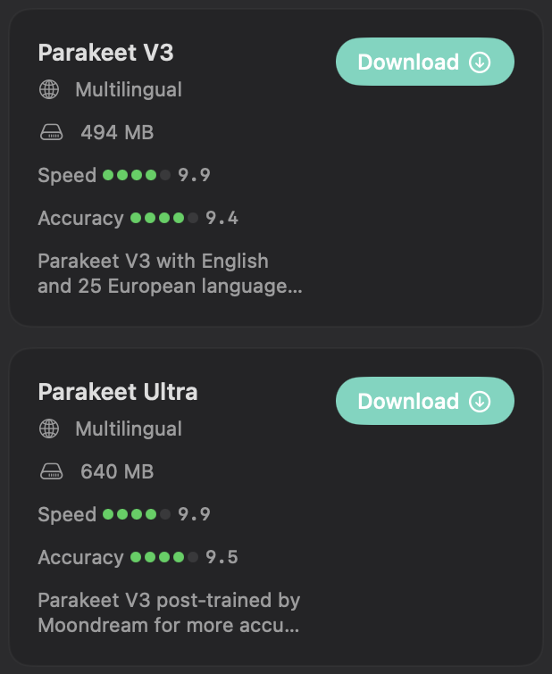
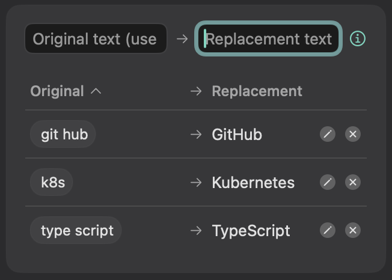
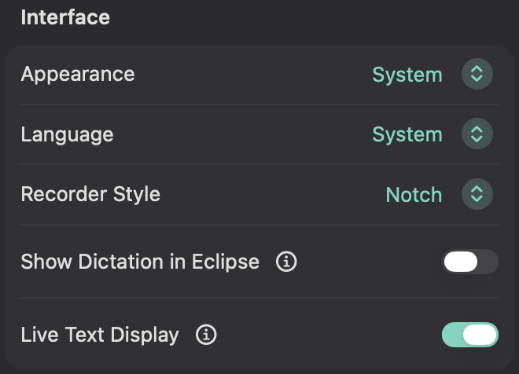

# Sotto

<p align="center"></p>

<p align="center"><strong>Dictation that stays on your Mac.</strong></p>

Sotto is a dictation app for macOS that runs entirely on your Mac. Double-tap Fn, speak, tap Fn once, and the text appears in whatever app you are typing in. Speech recognition runs locally with NVIDIA's Parakeet models or Whisper, so your audio never leaves the computer.

I built it for myself. I write in Romanian and English all day, often mixed in one sentence, and I wanted dictation that is fast, private and does not need an account or a subscription. It is a fork of [VoiceInk](https://github.com/Beingpax/VoiceInk), with the cloud parts removed and the shortcut, recorder and defaults changed to fit how I work. I use it every day on a MacBook Air M2, and I am sharing it in case it is useful to someone else.

## Features so far

### Fn to talk

Double-tap Fn to start and tap it once to stop, or hold Fn while you speak. A small pill of audio bars at the bottom of the screen follows your voice. You can move the recorder under the notch in Settings, or let Sotto hide the Dock while you record so the pill has room. When you stop, the text is pasted into the field you were typing in.


### Local models

Parakeet v3 is the default; Parakeet Ultra, Whisper and a few others are one click away. Each model downloads once and then runs on your Mac. Parakeet v3 and Ultra detect Romanian and English on their own, and a "Latin script only" filter, on by default, keeps stray Cyrillic words out.



### Dictionary

Teach Sotto the words it keeps getting wrong. Replacements fix the text after every transcription. The vocabulary list gives the optional text cleanup step the right spelling of names and terms.



### Works with Eclipse

Sotto and [Eclipse](https://github.com/AndreiStolojan/Eclipse), my notch app, are made to work together. With both running and the link turned on, the recording moves from the bottom pill into the notch. The link is off by default, and each app works fully on its own.




### Also from VoiceInk

- Modes: per-app and per-website settings for the model, language and text cleanup.
- A searchable history that Sotto can clean up automatically.
- Optional text cleanup with your own [Ollama](https://ollama.com) server or a command line tool you choose. Off unless you turn it on in a mode.

## Requirements

- macOS 15 or newer. Some models need macOS 26 (Apple Speech).
- Apple Silicon. Intel Macs may build, but I have not tested them.
- [Xcode](https://apps.apple.com/app/xcode/id497799835) 26 or newer, the full app, opened once. The Command Line Tools alone are not enough.
- About 4 GB of free space for the source, dependencies and build, plus 0.5 to 3 GB per speech model.

## Install

```sh
curl -fsSL https://raw.githubusercontent.com/AndreiStolojan/Sotto/main/install.sh | bash
```

The script checks your macOS and Xcode, downloads the source into `~/Library/Caches/Sotto`, builds it, quits Sotto if it is running, installs it to `/Applications` (or `~/Applications` if you cannot write there) and opens it. Run the same command again to update. The first build takes several minutes; later ones reuse the cache.

From a clone, `./install.sh` does the same: it still builds the published branch in the cache folder, not your checkout. To build your own changes, use `scripts/build.sh` (see [Building from source](#building-from-source)). `./install.sh --help` lists the options, and `./install.sh --uninstall` removes the app.

On first launch, onboarding asks for permissions and downloads Parakeet v3 (about 500 MB). After that, Sotto works offline.

There is no signed download yet, because I do not have an Apple Developer account. Your Mac builds the app itself and signs it ad-hoc. One side effect is that macOS sees every update as a new app, so it may ask for Microphone or Accessibility access again. If dictation stops pasting after an update, open System Settings > Privacy & Security > Accessibility, remove Sotto with the minus button, and add it again. To avoid this, see [Keep permissions across updates](#keep-permissions-across-updates).

## Beta channel

```sh
curl -fsSL https://raw.githubusercontent.com/AndreiStolojan/Sotto/main/install.sh | bash -s -- --beta
```

This builds the `beta` branch, where I try new features first, as a separate app called Sotto Beta. It has its own bundle ID, settings, history and permissions, so it can run next to the stable app without touching its data. Downloaded Parakeet models are shared between the two. Only run one at a time, since both listen for the Fn key.

## Permissions

| Permission | Why |
|---|---|
| Microphone | To record what you say. |
| Accessibility | To notice the Fn key in any app and to paste the transcript with Command-V. Also to send Option-Command-D if you turn on Dock hiding, and to read the selected text if a mode's text cleanup uses it. |
| Automation (only for website modes or AppleScript pasting) | To ask your browser for the current URL when a mode switches by website, or to paste through System Events if you pick that paste method. |
| Screen Recording (only if a mode uses screen context) | To read the text on screen with Apple's on-device OCR and give it to that mode's text cleanup. |

## Privacy

Your audio never leaves the Mac, and Sotto has no server, no account, no analytics and no update checks. A fresh install with default settings makes no network request except the model download you start. Here is everything that can leave the app, found by reading the code. Everything after the first item is off until you turn it on.

**Downloads.** `install.sh` fetches the source and Swift packages from GitHub and the pinned whisper.cpp framework from its GitHub release. In the app, models download only when you pick one: Parakeet, Nemotron and the voice detector from [FluidInference](https://huggingface.co/FluidInference) on Hugging Face, Whisper from [ggerganov/whisper.cpp](https://huggingface.co/ggerganov/whisper.cpp), Cohere Transcribe and SenseVoice from [handy-computer](https://huggingface.co/handy-computer). Apple Speech gets its language files from Apple.

**Text cleanup with Ollama.** Sotto talks to the Ollama address you set, `http://localhost:11434` by default. At launch it asks for the model list only if a mode or Auto Learn uses Ollama.

**Text cleanup with a Local CLI.** Sotto runs the command you choose. The built-in `claude`, `codex` and `copilot` templates call those companies' cloud services, so with them your text leaves the Mac.

What a cleanup provider receives, depending on what you turn on in the mode:

- the transcript and the prompt, plus your dictionary vocabulary
- the selected text, the clipboard and the on-screen text (OCR), each only if the mode asks for it
- the whole conversation, if the mode answers in the recorder (Respond)
- for Auto Learn: the text Sotto pasted and your corrected version of it, which it reads back from the text field

**Custom commands** in a mode run the shell command you write, with the transcript as input.

**Eclipse link.** A Unix socket in your home folder that only your account can open. Sotto sends the recording state and the microphone level, never text.

Recordings and transcripts stay in `~/Library/Application Support/ro.andrei.Voce` (`ro.andrei.Voce.beta` for Sotto Beta), settings in the app's preferences, Parakeet models in `~/Library/Application Support/FluidAudio/Models`. Settings can delete old transcripts and recordings automatically.

## Models

| Model | Size | License | Notes |
|---|---|---|---|
| Parakeet v3 | 494 MB | CC BY 4.0 | Default. 25 European languages, including Romanian and English. |
| Parakeet Ultra | 640 MB | CC BY 4.0 | Parakeet v3 further trained by Moondream. What I use daily. |
| Parakeet v2 | 474 MB | CC BY 4.0 | English only. |
| Parakeet Unified | 1.2 GB | CC BY 4.0 | English only, with live text while you speak. |
| Whisper (Tiny to Large v3 Turbo) | 75 MB to 2.9 GB | MIT | Slower than Parakeet on my Mac, but supports more languages and a forced language. |

The model library also lists Nemotron, Cohere Transcribe, SenseVoice and Apple Speech. [NOTICE.md](NOTICE.md) has the source and license of every model.

## Building from source

```sh
git clone https://github.com/AndreiStolojan/Sotto.git
cd Sotto
scripts/build.sh            # or scripts/build.sh --beta
```

The script downloads the pinned whisper.cpp framework, checks its SHA-256, builds Release for your Mac's architecture and prints the app's path. Swift packages use the versions in `Package.resolved`. The checks that CI runs:

```sh
bash scripts/test-core.sh
python3 scripts/check-recording-sounds.py
python3 scripts/validate-dock-controller.py
```

To work in Xcode, run `scripts/build.sh` once so the whisper.cpp framework is in `.build/deps`, then open `Voce.xcodeproj`. The Debug configuration builds "Sotto Dev" with its own bundle ID and data. The project signs ad-hoc, so you do not need an Apple developer team.

The project, scheme, Swift module and bundle ID (`ro.andrei.Voce`) still use the app's earlier name, Voce, so that existing permissions and data survive the rename.

### Keep permissions across updates

macOS ties permissions to the app's signature. With a certificate, the signature stays the same across builds:

1. Open Keychain Access, then Keychain Access > Certificate Assistant > Create a Certificate.
2. Name it, for example, "Sotto Local Signing". Set Identity Type to Self Signed Root and Certificate Type to Code Signing.
3. Install with `SOTTO_CODESIGN_IDENTITY="Sotto Local Signing" ./install.sh`. With the curl command, put the variable before `bash`.

## Known limits

- **Fn only.** The shortcut is fixed to the Fn (Globe) key. In System Settings > Keyboard, set "Press Fn key to" to "Do Nothing", and make sure Apple's own Dictation does not use Fn.
- **Dock hiding changes a system setting.** With "Hide Dock While Recording" on (off by default, Mini recorder only), Sotto turns on Dock auto-hide by sending Option-Command-D and turns it off again when you stop. If the Dock was already hidden, Sotto leaves it alone. If Sotto crashes mid-recording, it restores the Dock on the next launch.
- **Private and fragile APIs.** Pausing music during recording uses Apple's private MediaRemote framework. Pasting simulates Command-V. The Fn handling works around a Globe key event that macOS sends after a short tap. A macOS update can break any of these.
- **Language.** Parakeet cannot be forced to Romanian or English. Both use the Latin script, so the filter only rules out other scripts. Short Romanian words are where it makes most mistakes for me. Whisper accepts a fixed language but is much slower.
- **Tested on one Mac.** A MacBook Air M2 with macOS 26 and 27. Other setups may find bugs I have not seen.

## Fork of VoiceInk

Sotto started from [VoiceInk](https://github.com/Beingpax/VoiceInk) v2.21 (commit `640b0c8`) by [Prakash Joshi](https://github.com/Beingpax). VoiceInk is a well-made dictation app, and most of the code here, from the recording engine to modes and history, is his and his contributors' work. If you want a polished app with support and cloud options, use VoiceInk. Sotto has its own version numbers, starting at 0.1.0.

What Sotto changed:

- Removed cloud transcription providers, online text enhancement, API key storage, Sparkle updates, announcements, licensing and the related onboarding steps. Only local engines remain.
- Removed VoiceInk's Refine cleanup model, because its license allows use only with VoiceInk.
- Fixed the shortcut to Fn: double-tap to start, tap to stop, hold to talk, with protection against accidental taps.
- Made Parakeet v3 the default and added Parakeet Ultra, with only "Auto-detect" and "Latin script only" as language options, since Parakeet cannot force a single language. The Latin filter is on by default.
- Added optional Dock hiding while the bottom recorder shows, restored afterwards, including after a crash or a recording in a full-screen app.
- Replaced the default recorder with a small pill of audio bars at the bottom of the screen. It has no buttons: Fn starts and stops, Escape cancels, and three dots show while it transcribes. The notch recorder style keeps a round record and stop button.
- Added quieter start and stop sounds with their own volume setting.
- Restyled the main window in a dark theme with a grouped sidebar.
- Added the opt-in link to Eclipse over a local socket.
- Added a log line per dictation with the stop-to-paste timings, without transcript text.
- Replaced VoiceInk's name, icon and branding with Sotto's own.

Sotto does not track upstream VoiceInk anymore. Both projects are GPL v3.

## Credits and license

Sotto is free software under the [GNU General Public License v3](LICENSE). It is based on VoiceInk by Prakash Joshi, also GPL v3.

Thanks to [FluidInference](https://github.com/FluidInference) for FluidAudio and the Core ML model conversions, to NVIDIA for Parakeet, to Moondream for Parakeet Ultra, and to the [whisper.cpp](https://github.com/ggml-org/whisper.cpp) authors. [NOTICE.md](NOTICE.md) lists every dependency, bundled file and model with its license.

## Contributing

Issues and pull requests are welcome. See [CONTRIBUTING.md](CONTRIBUTING.md). Please report security problems privately, as described in [SECURITY.md](SECURITY.md).
